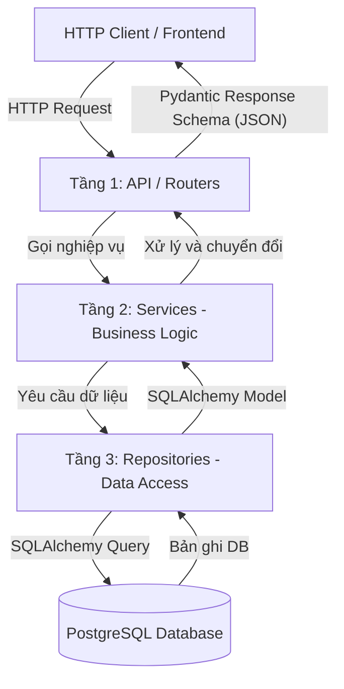

# Hướng dẫn Kiến trúc & Tiêu chuẩn Thiết kế Backend (FastAPI)

Tài liệu hướng dẫn tư duy thiết kế hệ thống và cấu trúc mã nguồn theo chuẩn **Layered Architecture (3-Tier)** kết hợp **DTO Pattern** trong FastAPI.

---

## 1. Tại sao dùng Kiến trúc 3 Tầng (Layered Architecture)?

Khi mới làm quen với FastAPI, sinh viên thường có thói quen viết toàn bộ câu lệnh truy vấn database, kiểm tra logic và xử lý dữ liệu ngay trong Router function:

```python
# ❌ Phản mẫu (Anti-pattern): Router làm quá nhiều việc
@router.post("/products")
def create_product(product_in: ProductCreate, db: Session = Depends(get_db)):
    # 1. Logic nghiệp vụ lẫn vào router
    if product_in.price < 0:
        raise HTTPException(400, "Price must be positive")
    # 2. Câu lệnh DB lẫn vào router
    db_obj = Product(name=product_in.name, price=product_in.price)
    db.add(db_obj)
    db.commit()
    db.refresh(db_obj)
    # 3. Gửi email thông báo lẫn vào router...
    return db_obj
```

Nhược điểm: Router trở nên khổng lồ (Fat Controller), không thể tái sử dụng logic ở nơi khác, và gần như không thể viết Unit Test độc lập nếu không kết nối vào database thật.

### ✅ Giải pháp: Phân định rạch ròi 3 tầng



---

## 2. Chi tiết trách nhiệm của từng tầng

### Tầng 1: API Layer (`app/api/`)
* **Nhiệm vụ:**
  * Định nghĩa HTTP method (`GET`, `POST`, `PUT`, `DELETE`) và đường dẫn URL.
  * Tiếp nhận dữ liệu, ép kiểu và validate sơ bộ bằng Pydantic Schemas.
  * Tiêm dependencies (`Depends(get_db)`, `Depends(get_current_user)`).
  * Gọi sang Tầng Service tương ứng.
  * Trả về HTTP status code phù hợp (`200 OK`, `201 Created`, `204 No Content`).
* **Quy tắc vàng:** **Tuyệt đối không import SQLAlchemy model hoặc viết câu lệnh `db.query()` tại đây.**

### Tầng 2: Service Layer (`app/services/`)
* **Nhiệm vụ:**
  * Chứa toàn bộ logic nghiệp vụ (Business Rules).
  * Kiểm tra tính hợp lệ về mặt logic: *Sản phẩm này còn đủ hàng trong kho không? Người dùng này đã mua gói này chưa? Mã giảm giá có còn hạn không?*
  * Quản lý **Database Transaction**: Nếu một nghiệp vụ gồm nhiều bước ghi dữ liệu (ví dụ: tạo đơn hàng + trừ kho), Service chịu trách nhiệm điều phối `commit()` hoặc `rollback()`.
  * Gọi Tầng Repository để lấy hoặc lưu dữ liệu.

### Tầng 3: Repository / Data Access Layer (`app/repositories/`)
* **Nhiệm vụ:**
  * Đóng gói mọi câu lệnh truy vấn dữ liệu của SQLAlchemy (`select`, `insert`, `update`, `delete`, `join`, `filter`).
  * Tầng này chỉ quan tâm: *Làm sao để lấy dữ liệu từ bảng A, lọc theo cột B nhanh nhất?*
  * Giúp trừu tượng hóa database: nếu sau này đổi thư viện query hoặc tối ưu câu lệnh SQL, tầng Service và API hoàn toàn không bị ảnh hưởng.

---

## 3. Phân biệt SQLAlchemy Model vs Pydantic Schema

| Tiêu chí | SQLAlchemy Model (`app/models/`) | Pydantic Schema (`app/schemas/`) |
| :--- | :--- | :--- |
| **Bản chất** | Đại diện cho cấu trúc bảng dưới Database. | DTO (Data Transfer Object) đại diện cho dữ liệu truyền qua mạng. |
| **Mục đích** | Mapping các cột, khóa chính, khóa ngoại, relationship. | Validate kiểu dữ liệu, format JSON, ẩn bớt các cột nhạy cảm. |
| **Ví dụ** | `User` có chứa cột `password_hash`, `deleted_at`. | `UserResponse` chỉ chứa `id`, `email`, `full_name` (loại bỏ hash). |

> **Quy tắc:** Không bao giờ trả trực tiếp SQLAlchemy Model ra ngoài client. Luôn bọc qua Pydantic Schema với cấu hình `model_config = ConfigDict(from_attributes=True)` (trong Pydantic v2).

---

## 4. Chuẩn hóa Định dạng Response và Lỗi (API Envelope)

### 4.1. Response thành công chuẩn
```json
{
  "success": true,
  "data": {
    "id": 12,
    "name": "Wireless Mouse",
    "price": 25.50
  },
  "message": "Product created successfully"
}
```

### 4.2. Response danh sách có phân trang chuẩn
```json
{
  "success": true,
  "data": {
    "items": [...],
    "total": 120,
    "page": 1,
    "page_size": 20,
    "total_pages": 6
  }
}
```

### 4.3. Response lỗi chuẩn (Custom Exception Handler)
Không trả về `{"detail": "..."}` mặc định của FastAPI, chuẩn hóa thành:
```json
{
  "success": false,
  "error_code": "PRODUCT_OUT_OF_STOCK",
  "message": "Sản phẩm 'Wireless Mouse' chỉ còn 2 chiếc trong kho, không đủ số lượng yêu cầu.",
  "details": null
}
```

---

## 5. Quy chuẩn Thiết kế RESTful API

1. **Danh từ số nhiều cho Resource:**
   * ✅ `/api/v1/products`, `/api/v1/orders`
   * ❌ `/api/v1/getProduct`, `/api/v1/create_order`
2. **Sử dụng đúng HTTP Method:**
   * `GET`: Chỉ đọc dữ liệu (idempotent, safe - không làm thay đổi trạng thái hệ thống).
   * `POST`: Tạo mới resource.
   * `PUT`: Cập nhật toàn bộ resource (thay thế).
   * `PATCH`: Cập nhật một phần trường dữ liệu.
   * `DELETE`: Xóa resource.
3. **HTTP Status Code mang tính ngữ nghĩa:**
   * `200 OK`: Đọc hoặc cập nhật thành công.
   * `201 Created`: Tạo mới thành công (trả về kèm thông tin resource vừa tạo).
   * `204 No Content`: Xóa thành công, không cần body trả về.
   * `400 Bad Request`: Lỗi logic người dùng vi phạm.
   * `401 Unauthorized`: Chưa đăng nhập hoặc token không hợp lệ / hết hạn.
   * `403 Forbidden`: Đã đăng nhập nhưng không đủ quyền hạn (ví dụ: customer gọi API của admin).
   * `404 Not Found`: Không tìm thấy resource tương ứng ID.
   * `422 Unprocessable Entity`: Dữ liệu gửi lên sai định dạng Pydantic.
   * `500 Internal Server Error`: Lỗi phát sinh ngoài dự kiến từ phía server.
